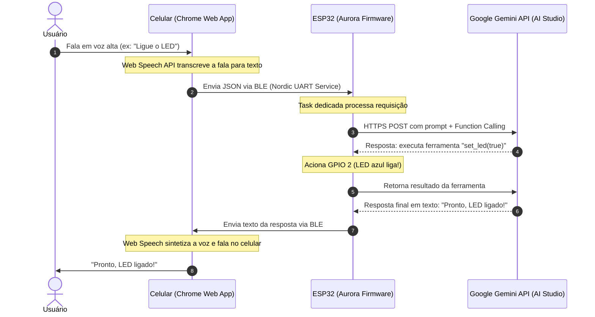

# Aurora — Assistente Pessoal de Voz para ESP32 (com Google Gemini)

Este projeto implementa um **assistente pessoal inteligente** onde o **ESP32 é o cérebro**.

Como a placa ainda não possui módulos físicos de microfone e alto-falante, o **celular Android** atua temporariamente como os "ouvidos" e a "boca" via **Bluetooth Low Energy (BLE)**, enquanto o **ESP32 processa a lógica, consulta o Gemini via Wi-Fi e controla os pinos e ferramentas da placa**.

---

## 🏛️ Arquitetura do Sistema



---

## 🚀 Como Gravar o Firmware no ESP32

O firmware já está **100% compilado e pronto** com a sua chave do AI Studio inclusa em `include/secrets.h`.

### Passo a passo para gravação:

1. Certifique-se de que o ESP32 está conectado na porta **COM3**.
2. No terminal do VS Code / PowerShell, execute:
   ```powershell
   .\flash.ps1
   ```
   *Ou diretamente via PlatformIO:*
   ```powershell
   & "$env:USERPROFILE\.platformio\penv\Scripts\pio.exe" run -t upload
   ```
3. **IMPORTANTE (Botão BOOT):**  
   Muitas placas ESP32 DevKit precisam que você **mantenha pressionado o botão `BOOT` (ou `0`) na placa** no instante em que o terminal mostrar `Connecting........_____....._____`. Assim que começar a porcentagem de gravação (`Writing at 0x...`), solte o botão!

---

## 📱 Como Usar no Celular (Android)

A pasta `web/` contém a aplicação web moderna desenvolvida para rodar no **Google Chrome do Android**:

### Opção 1: GitHub Pages (Mais recomendado e definitivo)
1. Crie um repositório no seu GitHub (ex: `esp32-assistente`).
2. Suba o conteúdo deste projeto.
3. Ative o **GitHub Pages** nas configurações do repositório apontando para a pasta raiz ou `/web`.
4. Abra o link gerado no Chrome do seu celular (ex: `https://seu-usuario.github.io/esp32-assistente/web/`).  
   *(Como o GitHub Pages possui certificado HTTPS válido, o Web Bluetooth e o Web Speech funcionam perfeitamente).*

### Opção 2: Testar no PC Primeiro
Você pode testar a interface diretamente no Google Chrome do próprio computador!
1. Abra a pasta `web/index.html` em um servidor local ou no navegador.
2. Clique no orbe central para conectar ao Bluetooth do ESP32 (`ESP32-Assistente`).
3. Fale no microfone do PC e o assistente responderá!

---

## 🛠️ Ferramentas que o Assistente executa na placa

O Gemini foi configurado com **Function Calling** nativo para executar comandos físicos no ESP32:

| Comando de Voz Exemplo | Ferramenta Acionada | Efeito no Hardware |
| :--- | :--- | :--- |
| *"Ligue o LED da placa"* | `set_led(on: true)` | Acende o LED azul no GPIO 2 |
| *"Desligue a luz"* | `set_led(on: false)` | Apaga o LED azul |
| *"Pisca o LED três vezes"* | `blink_led(times: 3)` | Pisca o LED no ritmo solicitado |
| *"Me lembre de tirar a pizza do forno em 15 minutos"* | `set_timer(seconds: 900)` | Cria um cronômetro no ESP32; ao vencer, o ESP32 avisa o celular por voz e pisca o LED |
| *"Quais lembretes eu tenho?"* | `list_timers()` | Consulta a lista de alarmes pendentes |
| *"Como você está?"* ou *"Qual a sua memória livre?"* | `get_device_status()` | Lê o heap livre, uptime, IP e temperatura do chip ESP32 |

---

## 🔮 Próximo Passo: Microfone e Alto-falante Físicos

Quando você adquirir os módulos de áudio dedicados para o ESP32:
- **Microfone I2S:** INMP441 (ligado aos pinos I2S do ESP32)
- **Amplificador/DAC I2S:** MAX98357A + Alto-falante de 3W

Você precisará apenas substituir a camada `BleLink` pela leitura do stream I2S com pipeline de áudio (ESP-ADF ou Arduino Audio Tools), mantendo todo o núcleo do Gemini e ferramentas que já construímos aqui!
